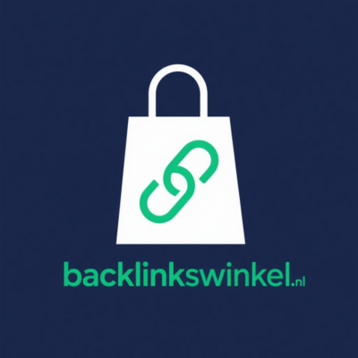

# Backlinkswinkel MCP server

**Search Dutch websites for backlinks, check metrics and prices, order after confirmation, track.**

Remote MCP server: `https://backlinkswinkel.nl/mcp` (Streamable HTTP) · Website: [backlinkswinkel.nl](https://backlinkswinkel.nl/)

## What it does

Backlinkswinkel is a catalogue of Dutch websites where you can order a backlink for SEO. The assistant searches and filters the catalogue by topic and metrics, shows a domain's details and price, checks your prepaid balance, orders one backlink after you confirm, and follows the order until the link is live. Topping up only creates a payment link; a person opens and pays it.

Ordering charges your prepaid credit and always needs your explicit confirmation.

## Connect

- **Server URL:** `https://backlinkswinkel.nl/mcp`
- **Transport:** Streamable HTTP
- **Authentication:** OAuth with PKCE (S256), dynamic client registration and client ID metadata documents, so MCP clients connect without manual setup.

**Claude (claude.ai, Desktop):** Settings → Connectors → Add custom connector → paste the server URL.

**Claude Code:**

```bash
claude mcp add --transport http backlinkswinkel https://backlinkswinkel.nl/mcp
```

**Cursor, VS Code, Cline, Windsurf and other clients** (`mcp.json` / `cline_mcp_settings.json`):

```json
{
  "mcpServers": {
    "backlinkswinkel": {
      "type": "http",
      "url": "https://backlinkswinkel.nl/mcp"
    }
  }
}
```

Cline uses `"type": "streamableHttp"`; see [llms-install.md](llms-install.md).

## Tools

| Tool | What it does |
|---|---|
| `search_domains / get_domain` | Search the catalogue; domain metrics and price. |
| `account_balance / topup` | Prepaid balance; payment link for a top-up. |
| `order_backlink / order_status` | Order one backlink (after confirmation) and track it. |

## Example prompts

- Find Dutch home-and-garden sites for a backlink under 100 euros.
- Order a backlink on that site to mysite.nl with anchor 'dakdekker Amsterdam'.
- What is the status of my last order?

## Links

- Website: https://backlinkswinkel.nl/
- Documentation: https://backlinkswinkel.nl/account/api/
- Privacy policy: https://backlinkswinkel.nl/privacy/
- Terms: https://backlinkswinkel.nl/algemene-voorwaarden/
- Support: mailto:info@backlinkswinkel.nl

## Keywords

buy backlinks Netherlands, Dutch link building, SEO backlinks, guest posts Dutch websites, link building marketplace, domain metrics.

Nederlands: backlinks kopen, linkbuilding, Nederlandse backlinks, SEO links, gastblog plaatsen, backlink bestellen, linkbuilding Nederland.

## More MCP servers by Samautomation

- [Scamchecker.nl](https://scamchecker.nl/): Check a suspicious email, SMS, WhatsApp message or link for scam signals (Netherlands, Belgium). ([listing](https://github.com/smrht/scamchecker-mcp))
- [Klussenbeheer](https://samdesk.nl/klussenbeheer/): Job management for Dutch service companies: jobs, customers, planning, quotes and invoices. ([listing](https://github.com/smrht/klussenbeheer-mcp))
- [Muziek maken met AI](https://muziekmakenmetai.nl/): Make an original song from a prompt or your own lyrics. Two versions per song, MP3 download. ([listing](https://github.com/smrht/muziekmakenmetai-mcp))
- [Beheer je WP](https://beheerjewp.nl/): Manage a WordPress site from your AI assistant: read, search, propose edits, Search Console data. ([listing](https://github.com/smrht/beheerjewp-mcp))
- [UlazAI Media](https://ulazai.com/): Create private AI images with your UlazAI account: pick a model, confirm, generate, download. ([listing](https://github.com/smrht/ulazai-mcp))
- [Backlinksbeheer](https://backlinksbeheer.nl/): Read your stored backlinks, link checks and lost-link alerts per domain. Read-only. ([listing](https://github.com/smrht/backlinksbeheer-mcp))
- [Samautomation Video](https://samautomation.work/): Render an MP4 from your own images, clips, voice-over and timed captions. JSON to video. ([listing](https://github.com/smrht/samautomation-video-mcp))
- [PDF Samenvoegen](https://pdfsamenvoegen.nl/): Merge your own PDFs in a confirmed order and get one downloadable PDF. ([listing](https://github.com/smrht/pdfsamenvoegen-mcp))
- [Diamond Painting Converter](https://diamondpaintingconverter.com/): Find your purchased diamond painting patterns and download the PDF with DMC colour legend. ([listing](https://github.com/smrht/diamondpaintingconverter-mcp))
- [Nummerschilderen.com shop advisor](https://nummerschilderen.com/): Search paint-by-number kits, get size and price advice for your own photo, shop info. No login. ([listing](https://github.com/smrht/nummerschilderen-mcp))
- [DiamondPaintingWinkel.nl shop advisor](https://diamondpaintingwinkel.nl/): Search diamond painting kits, get size and price advice for your own photo, shop info. No login. ([listing](https://github.com/smrht/diamondpaintingwinkel-mcp))
- [AI Rechtshulp](https://ai-rechtshulp.nl/): Search Dutch and EU case law with ECLI sources and verify quotes against the judgment. ([listing](https://github.com/smrht/ai-rechtshulp-mcp))
- [SamDesk Support](https://samdesk.nl/support/plugin/): Read your SamDesk support inbox, find customer agreements and draft replies. Read-only. ([listing](https://github.com/smrht/samdesk-support-mcp))

## Publisher

Samautomation, Wognum, the Netherlands · https://samautomation.work

This repository holds the public listing (README, `server.json`, install notes). The server itself is hosted by the publisher; there is nothing to install or build.
